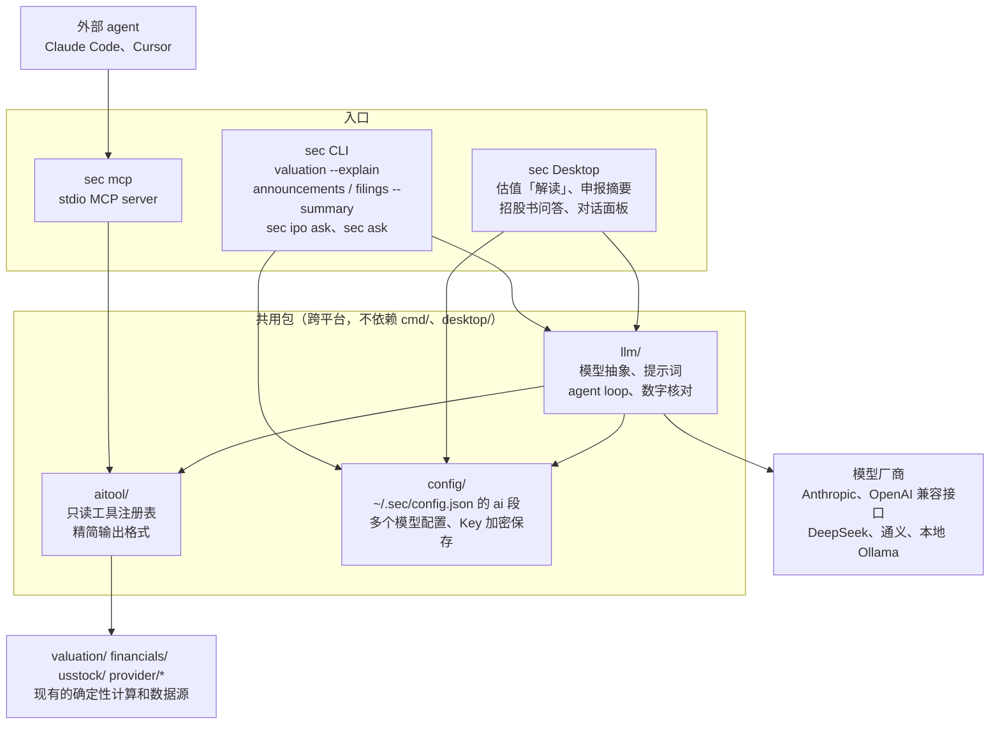

# AI/LLM 接入设计

本文记录 sec 接入大模型的设计和拆分，以及已实现的接口约定。实现进度见 [TODO](../TODO.md) 的 AI/LLM 部分，每一步一个 PR。

## 目标与边界

sec 已经能从官方和公开数据源算出行情、财报、估值和宏观数据，缺的是「把多个结果串起来、用人话解释」。接入大模型只补这一层：

- **数字只来自 sec**：所有数值、同比、变化量和估值都由 Go 代码算好交给模型，模型只负责选择调用哪些工具、串联结果和解释，不自己计算、不估算、不补全缺失值。
- **口径原样保留**：推导标记 `*`、以 `_note` 结尾的说明（`source_note`、`shares_note`、`dividends_note`、`peers_note` 等）和数据截止日期原样交给模型，回答里必须保留。`null` 表示上游缺失或不适用，不能说成 0。
- **不给买卖建议**：只解释数据，不说买入、卖出、持有、目标价或仓位（国内证券投资咨询需持牌）。估值的 `assessment`（偏低区间、合理区间、偏高区间）是规则机械判定，回答里要说明这一点，并带上 `disclaimer`。
- **CLI 和 Desktop 都支持**：模型配置、提示词、数字核对和 agent loop 两边共用，同一个功能在 CLI 和 Desktop 上行为一致。`sec mcp` 另外给 Claude Code、Cursor 等外部 agent 使用，不需要配置模型。

不做：自动交易、定时自主运行的 agent、embedding 向量库、把模型输出写回 sec 的数据或缓存（摘要缓存除外，见下文）。

## 整体结构



`sec mcp` 不经过 `llm/`，也不读模型配置：模型由外部 agent 自己提供，sec 只提供工具。

新增两个跨平台包，都放在仓库根目录，和 `valuation/`、`financials/` 同级：

- **`aitool/`**：工具注册表和精简输出格式。只依赖现有的业务包和 provider，不依赖 `cmd/`、`desktop/` 和任何模型 SDK。`sec mcp`、`sec ask` 和 Desktop 对话都从这里取工具。
- **`llm/`**：模型接入抽象、提示词组装、agent loop 和数字核对，CLI 和 Desktop 共用。

模型配置放在已有的 `config/` 包（`~/.sec/config.json`），不新建配置文件。

`cmd/` 和 `desktop/` 只做入口：参数解析和终端输出、HTTP 接口和界面。凡是两边共用或要在 Linux CI 上测的逻辑（工具输出、提示词组装、agent loop、数字核对）都放在 `aitool/` 和 `llm/` 里，`desktop/` 只放接口和界面，不放这些逻辑。

## 工具注册表（aitool）

### 接口

```go
// Tool 是一个只读工具，参数和返回都是 JSON。
type Tool struct {
	Name        string          // 英文 snake_case，如 get_valuation
	Description string          // 给模型看的中文说明：做什么、什么时候用、返回什么
	InputSchema json.RawMessage // JSON Schema，MCP 和模型 tool use 共用
	Call        func(ctx context.Context, input json.RawMessage) (*Result, error)
}

// Registry 按名字查找工具，顺序固定，便于测试和生成文档。
type Registry struct{ ... }

func Default(macro MacroSource) *Registry // 第一批 7 类工具；宏观数据由 cmd/macro 注入，见 sec mcp 文档
```

工具全部只读：不改自选、不写配置、不下载文件。参数错误返回带中文说明的 error，上游失败返回 error 并写日志；MCP 和对话都把 error 文本原样交给模型，让它告诉用户哪一步失败了，不让它猜数据。

### 精简输出格式

`--json` 的结构面向脚本，字段多、历史长（10 年财报、几百根 K 线），直接交给模型既费 token，又容易让模型自己去算同比。工具输出另定一个带版本号的信封，不直接暴露 `--json` 的结构（[JSON 输出约定](json.md) 里已经说明）：

```json
{
  "schema_version": "1",
  "tool": "get_valuation",
  "subject": {"code": "SH600519", "name": "贵州茅台", "currency": "CNY"},
  "as_of": "2026-11-05",
  "source": "东方财富估值、业绩报表；新浪行情",
  "notes": ["PE、PB 历史分位按近 10 年日数据计算", "股息率用最近一个完整财年的现金分红"],
  "disclaimer": "估值结果由规则和假设机械计算，不构成投资建议。",
  "data": { ... }
}
```

- `as_of` 是数据本身的截止日期（交易日、报告期或统计期），不是查询时间。同一个结果里有多个时点（比如价格是今天、财报是上季度）时，`data` 里对应的部分各带自己的日期。
- `notes` 汇总所有非空的 `*_note` 和推导说明；带 `*` 的推导值在 `data` 里用 `"derived": true` 标出，不靠字符串里的星号。
- 派生值在工具里算好：同比、环比、区间涨跌幅、最大回撤、历史分位等，模型只需引用。
- 每个工具有输出预算（目标 4 KB 以内），超出时截短历史并在 `notes` 里写明截了什么。

### 第一批工具

| 工具 | 复用 | 输出要点 |
| --- | --- | --- |
| `search_security` | `provider/sina` 搜索 | 代码、名称、市场、证券类型，最多 10 条 |
| `get_quote` | `cmd/quote` 用到的行情 provider | 最新价、涨跌幅、成交额、时间和时区；基金净值标明 `nav` |
| `get_kline_summary` | `provider/eastmoney` K 线 | 区间首尾价、涨跌幅、最高最低、最大回撤、均线、平均成交额，加最近 20 根 K 线；不返回全部 K 线 |
| `get_financials` | `financials/`（A 股）、`financials.FromSEC`（美股） | 最近 5 个年度（或 8 个季度）的营收、净利润、毛利率、ROE、经营现金流等关键项及同比；A 股和美股统一成同一结构 |
| `get_valuation` | `valuation.Analyze` | PE/PB/PS 及历史分位、股息率、PEG、DCF 情景、`signals` 和 `assessment`、全部 `_note`、`disclaimer` |
| `list_filings` | `provider/cninfo` 公告、`provider/edgar` 申报 | 标题、类型、日期、链接，最多 20 条；不含正文 |
| `get_macro_series` | `provider/macrodata` 统一导出 | 按 `series` 的口径说明（频率、季调、价格基准）+ 最近 12 期观测；同比用官方值或标明是计算值 |

宏观指标很多，`get_macro_series` 用一个 `indicator` 参数加枚举，枚举从 Desktop 宏观页已有的目录生成，不为每个指标单独建工具。

## sec mcp

- 命令：`sec mcp`，stdio 传输，只暴露 `aitool.Default(macro.AISource())` 里的工具，不暴露 resources 和 prompts。
- stdout 只给 MCP 协议用：日志一律写 stderr，任何 `fmt.Print` 都不能走到 stdout。
- 实现优先用官方 Go SDK（`github.com/modelcontextprotocol/go-sdk`），新增依赖在该 PR 里评估；如果不合适再手写 JSON-RPC。
- 每次工具调用设超时（默认 30 秒，和 Desktop 的美股接口一致），复用现有的 HTTP 重试和缓存。
- 文档 `docs/mcp.md` 给出 Claude Code、Cursor 的配置示例，并说明输出格式和版本。

## 模型接入（llm）

### 抽象

```go
type Client interface {
	// Chat 发一轮请求，返回文本或工具调用。
	Chat(ctx context.Context, req Request) (*Response, error)
}

type Request struct {
	System    string
	Messages  []Message
	Tools     []Tool // 名字、说明、InputSchema，由调用方从 aitool 注册表换过来
	MaxTokens int    // 0 表示 16000
}
```

`llm.New(profile, key)` 按模型配置的实际协议创建客户端，`key` 来自 `config.AIConfig.ResolveKey`；不是本机模型、也不是自定义厂商（自建网关可能不需要认证）时没有 Key 直接报 `llm.ErrMissingKey`，和设错了 Key 的 401 区分开。接口地址在 `base_url` 的路径后面拼接，保留查询参数（如 `?api-version=`）。两个实现，都用 `net/http` 直接调用（`utils.MakeRequest`，POST 不自动重试），不引入厂商 SDK，依赖保持最少（实现见 `llm/`）：

- **Anthropic**：`POST {base_url}/v1/messages`，`x-api-key` 和 `anthropic-version: 2026-10-21`，原生 tool use；不发送 `temperature`、`top_p`、`top_k`（这个版本会拒绝）。助手消息的原始内容块（含 `thinking` 块和签名）原样发回，不重新拼装：thinking 块绑定了对话，改动会被拒绝或丢失推理；调用方改了回复的文字或工具调用时按改过的内容重新拼装（不再带 thinking 块），回复内容为空时不保存；原始内容只发回给产生它的厂商，换到别家的 Anthropic 兼容接口时重新拼装（thinking 签名对不上）。`base_url` 已经以 `/v1` 结尾时只加 `/messages`。
- **OpenAI 兼容**：`POST {base_url}/chat/completions` + function calling，覆盖 OpenAI、DeepSeek、通义千问、Kimi、智谱和本地 Ollama。按厂商处理差异：OpenAI 用 `max_completion_tokens`（新模型不接受 `max_tokens`），其他用 `max_tokens`；没有 Key 时不发 `Authorization`；部分本机模型调用工具时 `finish_reason` 仍是 `stop`、不给调用 id，以是否有工具调用为准、随机补 id；DeepSeek、Kimi 等返回的 `reasoning_content` 原样发回给产生它的厂商（DeepSeek 要求请求带工具时发回之前所有助手消息的推理内容，否则返回 400；Kimi 要求原样保留每条助手消息的推理内容），不发给别的厂商；回复的 `content` 是内容块数组时按顺序拼接文字；不合法的工具参数保留成字符串，交给参数校验报错让模型修正，发回时 Anthropic 发空对象、OpenAI 兼容接口发原来的字符串。
- 停止原因统一成 `end`、`max_tokens`、`tool_use`、`refusal`、`other`，原始值另外保留。接口错误统一成 `llm.APIError`（状态码、厂商错误类型和信息、`Retry-After`），`Retryable()` 区分限流、超时、5xx 和参数、认证错误；`llm.IsRetryable(ctx, err)` 把网络超时、连接被重置或中断也算可重试，连接被拒绝、证书错误、域名找不到不算，调用方取消后也不算；`Retry-After` 支持秒数、HTTP 日期和 `retry-after-ms`；错误里不含 Key。没有文字、工具调用和工具结果的消息在本地报错，说明是第几条；没有参数 Schema 的工具发空的 object。
- `llm.Fake` 按顺序返回预设回复并记下请求，CI 用它测试，不调用真实模型。

不支持工具调用的模型只能用解读和摘要，不能用 `sec ask` 和对话面板，CLI 报错和设置页都给出提示。

### 流式输出（2026-11-10 调研与实现方案）

流式输出优先用于已实现的估值解读，沿用 Anthropic Messages 和 OpenAI Chat Completions。保留 `Client.Chat` 及完整 JSON 输出，增加可选的 `ChatStream(ctx, req, emit)`：持续发送正文增量，同时组装最终 `Response`，让提示词、数字核对、缓存和未来工具循环共用。

协议依据：

- [OpenAI 流式事件](https://developers.openai.com/api/reference/resources/chat/subresources/completions/streaming-events)：`stream: true` 后从 `choices[].delta` 取增量，正文与工具参数分别拼接，以 `[DONE]` 结束。请求 `stream_options.include_usage` 时，最后可能有 `choices: []` 的统计包，不是空回复错误。
- [Anthropic 流式协议](https://platform.claude.com/docs/en/build-with-claude/streaming)：按 `message_start`、内容块 start/delta/stop、`message_delta`、`message_stop` 组装消息；`message_delta.usage` 是累计值，不能逐包相加。处理 `ping` 和流内 `error`，保留 thinking、signature 和工具参数分片，正文与推理内容分离。
- [DeepSeek](https://api-docs.deepseek.com/api/create-chat-completion/) 的用量可能放在最后一个内容块，而不是独立的空 choices 包；[通义](https://help.aliyun.com/zh/model-studio/stream) 的部分模型只支持流式调用；[Ollama](https://docs.ollama.com/api/openai-compatibility) 也支持 OpenAI 兼容流式接口。自定义网关仍需单独验证，不能假设兼容所有扩展参数。

Desktop 继续使用 `POST /api/v1/ai/valuation`，请求 `Accept: text/event-stream` 时返回 SSE，否则保留 JSON。前端用 `fetch`、`ReadableStream` 和 UTF-8 增量解码读取 POST 响应；原生 `EventSource` 不支持当前的 JSON POST 请求体。参考 [Fetch 流式读取](https://developer.mozilla.org/en-US/docs/Web/API/Fetch_API/Using_Fetch) 和 [SSE 格式](https://developer.mozilla.org/en-US/docs/Web/API/Server-sent_events/Using_server-sent_events)。

应用层事件不直接暴露厂商协议：`status` 表示取数、生成、核对阶段，`meta` 携带证券、模型配置、数据截止日期和免责声明，`delta` 追加正文，`done` 返回完整 `Explanation`，`error` 是脱敏后的失败终态。`done` 与 `error` 二选一，连接提前结束不能当成成功。Go 服务每次输出后调用 `http.ResponseController.Flush`；取数逻辑与 HTTP 错误输出分离，避免开始 SSE 后再写普通 JSON 错误。

正确性约束：

- 生成中的正文是尚未完成核对的草稿；免责声明先显示，完整回答后执行 `Verify` 并用最终结果替换草稿。只有上游正常完成且未截断的结果才缓存，取消或异常断流不缓存半篇回答；缓存命中直接返回完整结果。
- SSE 解析处理 UTF-8 字符、半行、跨网络块事件、CRLF、多行 data 和心跳，明确限制事件和总响应大小，不能按一次网络 read 解析一次 JSON。
- 鉴权、输入和配置错误在流开始前返回 HTTP 错误；取数和模型错误发生在流开始后，以 `error` 事件结束，事件内携带对应 `status`。模型原始错误正文不返回 Desktop 客户端，不输出 Key 或推理内容；CLI 和 Desktop 只显示 `llm.PublicError` 给出的厂商、HTTP 状态码或流内错误和错误类型代码（如 `insufficient_quota`），类型不是代码格式时也不显示。流式 POST 不自动重发，避免重复内容和额外调用。
- 沿用 `AbortController → request context → 模型请求` 的取消链；写出或 Flush 失败时终止上游。保留明确的总超时，心跳不延长总超时。取估值和模型首段输出前的耗时仍存在，通过阶段状态展示。
- CLI 的终端正文可以流式显示，管道及 `--json` 继续返回完整结果；连接测试保持完整结果输出。

实现按以下顺序分层，便于审查：公共 SSE 解析及 OpenAI 兼容客户端 → Anthropic 客户端 → 共享估值解读和 Desktop 端到端 → CLI 终端。每层使用假服务测试，不调用真实模型。验收覆盖上游尚未结束时已经收到首段正文、取消、流内错误、缺少结束标记、用量统计、工具参数分片、最终核对及缓存。

实现入口为 `llm.StreamingClient.ChatStream` 和 `ValuationExplainer.ExplainStream`。SSE 单事件最多 1 MiB，模型和应用流总量最多 16 MiB；服务每 15 秒发送注释心跳，单次写出最多等待 15 秒，取估值最多 20 秒（美股 40 秒）、模型最多 5 分钟。自定义 OpenAI 网关不附加 `stream_options`；其他 OpenAI 兼容厂商请求 `include_usage`，均兼容统计跟随最后一段正文返回。

Desktop 请求示例（正式应用仍需原有 cookie 鉴权及同源校验）：

```http
POST /api/v1/ai/valuation
Content-Type: application/json
Accept: text/event-stream

{"code":"SH600036","profile":"deepseek"}
```

事件的 JSON 数据分别是：`status` / `delta` 为 `{"text":"…"}`，`meta` 为 `ex_code`、`name`、`as_of`、`model`、`profile`、`disclaimer`、`cached`，`done` 为原 JSON 接口的完整 `Explanation`，`error` 为 `{"message":"…","status":502}`。缓存命中不发送虚构的正文增量，直接发送 `meta` 和 `done`；前端只把 `done` 当作成功，保留断流前草稿并标明未完成核对。CLI 直接连接终端时自动流式输出，重定向、管道和 `--json` 保持原输出方式；暂不增加自动降级，网关不支持 SSE 时明确报错。

### 配置与密钥

CLI 和 Desktop 共用一份配置，在任意一边设置后另一边直接可用。

| 配置 | 存放位置 |
| --- | --- |
| 是否启用、默认配置、各个模型配置 | `~/.sec/config.json` 新增的 `ai` 段，和 `sec_edgar_email` 同一个文件，沿用现有的文件锁 |
| API Key | 每个配置各自一个：环境变量，或 `config.json` 里加密保存的 Key |
| 加密密钥 | `~/.sec/secret.key`，首次保存 Key 时生成，和 `config.json` 分开存放，所有配置共用 |

`config.json` 的 `ai` 段可以保存多个模型配置，每个配置写明厂商、模型和 Key，协议和地址默认用厂商的官方设置，切换时只改 `default` 或临时指定，不用改别的字段：

```json
{
  "sec_edgar_email": "you@example.com",
  "ai": {
    "enabled": true,
    "default": "claude",
    "profiles": {
      "claude": {
        "provider": "anthropic",
        "model": "claude-sonnet-5-5",
        "api_key": "enc:v1:3q2+7w...（base64）"
      },
      "ds": {
        "provider": "deepseek",
        "model": "deepseek-chat",
        "api_key": "enc:v1:9xk2Lm...（base64）"
      },
      "local": {
        "provider": "ollama",
        "model": "qwen3"
      },
      "gw": {
        "provider": "custom",
        "api": "openai",
        "base_url": "https://llm.corp.example/v1",
        "model": "x",
        "api_key_env": "CORP_LLM_KEY"
      }
    }
  }
}
```

- `profiles` 是以配置名为键的对象，名字天然唯一，命令里直接用名字引用。名字只能用小写字母、数字和 `-`，以字母或数字开头，最长 32 个字符。Desktop 下拉框按名字排序显示。
- `default` 是不指定时使用的配置，必须是 `profiles` 里存在的名字。
- `provider` 是模型厂商，必填，只能从内置列表里选（`config.AIProviders`），列表给出每个厂商的显示名、默认协议、官方地址和默认环境变量：

  | `provider` | 厂商 | 默认 `api` | 官方地址 | 默认环境变量 |
  | --- | --- | --- | --- | --- |
  | `anthropic` | Anthropic | `anthropic` | `https://api.anthropic.com` | `ANTHROPIC_API_KEY` |
  | `openai` | OpenAI | `openai` | `https://api.openai.com/v1` | `OPENAI_API_KEY` |
  | `deepseek` | DeepSeek | `openai` | `https://api.deepseek.com` | `DEEPSEEK_API_KEY` |
  | `qwen` | 通义千问（阿里云百炼） | `openai` | `https://dashscope.aliyuncs.com/compatible-mode/v1` | `DASHSCOPE_API_KEY` |
  | `moonshot` | 月之暗面 Kimi | `openai` | `https://api.moonshot.cn/v1` | `MOONSHOT_API_KEY` |
  | `zhipu` | 智谱 GLM | `openai` | `https://open.bigmodel.cn/api/paas/v4` | `ZAI_API_KEY` |
  | `ollama` | Ollama（本地） | `openai` | `http://localhost:11434/v1` | 无 |
  | `custom` | 自定义（自建网关、代理等） | 必填 | 必填 | 无 |

  通义千问和 Kimi 分中国和国际两个区域，Key 只能在签发它的区域使用，默认是中国区域，国际区域的 Key 要填 `base_url`。其他厂商用 `custom`。厂商列表用于默认值、隐私提示和以后 `llm/` 里各厂商的差异处理，列表外的值是无效配置，不猜测。
- `api` 是接口协议：`anthropic`（Messages API）或 `openai`（OpenAI 兼容接口），为空时用厂商的默认协议。部分厂商同时提供两种协议（比如 DeepSeek 的 Anthropic 兼容接口），这时填 `api` 和对应的 `base_url`：官方地址只对应默认协议，`api` 和默认协议不同时 `base_url` 必填。
- `base_url` 为空时用厂商的官方地址；`custom` 必须填 `api` 和 `base_url`；`model` 必填。`base_url` 不能带用户名密码、`#` 片段，也不能在查询参数里放 Key、token 或密码（`api-version` 这类普通参数可以），地址会明文写进文件。
- 每个配置只有一个 `api_key`（密文）；`api_key_env` 指定从哪个环境变量读 Key。本地模型两者都可以不填。
- Key 的读取顺序：
  1. `api_key_env` 非空时读这个环境变量，这个环境变量没有设置时报错，不往下找；用 `set-key` 保存 Key 时会清空 `api_key_env`，否则保存的 Key 用不上；
  2. 否则读 `api_key` 解密；
  3. 都没有时，读厂商的默认环境变量（见上表）。`base_url` 改成官方地址以外的地址时不读（只差结尾的 `/` 仍算官方地址），避免把厂商的 Key 发给别的服务。

  默认环境变量按厂商区分，DeepSeek 配置不会误用 `OPENAI_API_KEY`。环境变量适合 CI、服务器和临时覆盖。
- 是否本机按实际地址判断（`localhost` 或回环地址），不按厂商：本机模型的查询内容不出本机，隐私提示据此说明；指向其他主机的 Ollama 不算本机。
- `thinking` 为空时用厂商和模型的默认行为；`off` 关闭思考（推理）。思考 token 也计入输出上限，长公告的一块可能用完上限、没有正文（实测 `deepseek-v4-pro` 摘要 12k 字的一块要 11k～16k+ token），也更慢。各厂商关闭思考的参数不同，只在实现并核实过参数的厂商、协议和官方地址上允许 `off`（`AIProfile.ThinkingOffSupported`）：改了 `base_url` 的配置可能是转发同一模型的第三方服务，参数不一定相同。其他情况报「暂不支持关闭思考」，不发出厂商不认识的参数，也不让用户以为已经关闭；CLI 把原来关闭思考的配置改到不支持的厂商时提示同时加 `--thinking ""`。允许关闭的组合和客户端实际发出的参数由 `TestThinkingOffSupportedSendsParams` 检查一致：

  | 厂商（协议） | 请求参数 | 核实 |
  | --- | --- | --- |
  | DeepSeek | `"thinking": {"type": "disabled"}` | 实测：`deepseek-v4-pro` 推理由 749 字降到 0，输出由 337 降到 64 token，答案相同；`deepseek-reasoner`（实际为 `deepseek-flash`）推理由 240 字降到 0；`deepseek-chat` 默认不推理，带参数也正常 |
  | 通义千问 | `"enable_thinking": false` | 按[百炼文档](https://help.aliyun.com/en/model-studio/deep-thinking)，未实测；默认是否思考因模型而异。国际区域要填 `base_url`，不是默认官方地址，暂不能关闭 |
  | 智谱 | `"thinking": {"type": "disabled"}` | 按[智谱文档](https://docs.bigmodel.cn/cn/guide/capabilities/thinking.md)，未实测；GLM-4.5～5.2 支持，GLM-5.3 不能关闭，会报错而不是静默忽略 |

  表中都是 OpenAI 兼容接口、官方地址。按文档加入的厂商不能保证每个模型都遵守：只思考的模型（如部分 qwq、GLM-4.7）可能忽略关闭参数。所以关闭思考后，回复里仍有 `reasoning_content` 或推理 token 时，`llm.Response.ThinkingIgnored` 标为 true 并记警告日志；`sec config ai test` 和 Desktop 的测试连接显示「配置关闭了思考，但模型仍在思考」，用户可以先测试确认设置生效。

  不支持的有：Anthropic 协议（Claude 各模型规则不同，Claude Opus 5.5 不能关闭，Sonnet 5.5 要用 `between_tools`，Haiku 5.5 只在 effort `high` 及以下可关，没有统一的关闭方式）；OpenAI（`reasoning_effort: "none"` 只有 gpt-5.1 及以后支持，其他模型直接返回 400，错误里不说明和思考设置有关）；Kimi（`kimi-k2-thinking` 总是思考，K3 改用 `reasoning_effort`）；Ollama（OpenAI 兼容接口是否生效说法不一）。Desktop 设置页「AI 模型」的配置表单有「关闭思考」开关，列表显示思考设置；设置接口返回 `thinking_off_providers`，表单按和 `ThinkingOffSupported` 相同的规则（去掉空白后）决定开关能不能打开，不能时显示支持的厂商。开关总是显示真实的设置，页面不悄悄改掉：已经关闭思考的配置换到不支持的厂商、协议或地址时仍显示勾选并提示取消勾选，原样提交时后端拒绝并说明原因，和 CLI 一致。保存什么以后端校验为准，两边规则不一致时最多是报错，不会存成别的值。
- 以后需要按配置区分的其他设置（如 `max_tokens`、超时）作为可选字段加到每个配置里，属于兼容变更，第一版不加。

### 选择配置

- **CLI**：所有调用模型的命令（`--explain`、`--summary`、`sec ipo ask`、`sec ask`）都支持 `--ai <配置名>`，不写时用 `default`。
- **Desktop**：解读按钮、摘要按钮和对话面板旁边有配置下拉框，默认选中 `default`；临时切换只对当前页面有效，不改 `default`，要改默认值去设置页。
- 缓存键里的「模型」用配置实际的 `api` + `base_url` + `model`，不用配置名，改名或复制配置不会让缓存失效，换了模型才会重新调用。

### API Key 加密

- **算法**：AES-256-GCM，只用 Go 标准库 `crypto/aes`、`crypto/cipher`，不新增依赖。每次加密用新的随机 nonce，配置名作为附加认证数据（AAD），把一个配置的密文复制到另一个配置下会解密失败。
- **格式**：`enc:v1:` + base64(nonce ‖ 密文)。`v1` 留给以后更换算法或密钥来源。
- **加密密钥**：`~/.sec/secret.key` 存 32 字节随机数，首次保存 Key 时用 `crypto/rand` 生成，文件权限 `0600`。先写临时文件再硬链接到目标位置，CLI 和 Desktop 同时第一次保存 Key 时只会生成一个密钥，不会互相覆盖；文件系统不支持硬链接（exFAT、部分网络盘）时改用 `O_EXCL` 直接创建。生成前删掉超过 1 分钟的 `.secret-*` 临时文件，它们是进程中途退出留下的，含有完整密钥。读取时发现权限过宽（组或其他用户可读）就报错，提示 `chmod 600`；文件大小不是 32 字节时报已损坏。Windows 上文件权限位不起作用，不检查权限，依靠用户目录本身只对当前用户开放，第一版不另设 ACL。实现见 `config/secret.go`。
- **防护范围**：`config.json` 单独泄露（贴到 issue 里排查问题、同步 dotfiles、备份到网盘）时 Key 不会泄露；`config.json` 可以放心用 `sec config` 显示和分享。不防能读取用户主目录的本机程序，它能同时读到 `secret.key`。文档和设置页都如实说明这一点，不称之为「安全存储」，并提醒不要把 `secret.key` 和 `config.json` 一起同步或备份。
- **密钥丢失**：`secret.key` 被删或换了机器后，已保存的 Key 无法解密。此时报错「API Key 无法解密，请重新设置」，不自动删除密文；重新设置时生成新密钥并覆盖。`secret.key` 已损坏（大小不对）时同样处理，重新设置 Key 时生成新密钥替换：损坏的密钥解不开任何 Key，替换不会丢东西。权限过宽时只报错，不替换。
- **以后增强**：可以把 `secret.key` 改存到系统钥匙串（macOS Keychain、Windows Credential Manager），`config.json` 的格式不用变，用 `v2` 区分。第一版不做，避免引入依赖和处理没有钥匙串的 Linux。

设置方式：

- **CLI**：配置是嵌套结构，用 `sec config set` 的点号路径太长，改为 `sec config ai` 子命令：

  ```bash
  sec config ai list                     # 列出所有配置：名字、厂商、协议、地址、模型、Key 来源和末 4 位，标出 default；--json 输出 JSON
  sec config ai add ds --provider deepseek --model deepseek-chat
  sec config ai add gw --provider custom --api openai --base-url https://llm.corp.example/v1 --model x
  sec config ai edit ds --model deepseek-reasoner   # 修改 provider、api、base-url、model、api-key-env、thinking
  sec config ai edit ds --thinking off   # 关闭思考，--thinking "" 恢复厂商默认
  sec config ai set-key deepseek         # 设置 Key
  sec config ai unset-key deepseek       # 删除保存的 Key
  sec config ai use deepseek             # 设为 default
  sec config ai test deepseek            # 发两个最小请求测试连接和工具调用，不写名字时测 default
  sec config ai remove deepseek
  sec config ai enable / disable
  ```

  - `test` 先发一句固定的测试文字（「请只回复 OK」）检查地址、Key 和模型，显示耗时、实际模型和用量；再让模型调用一个测试工具，判断是否支持工具调用（`sec ask` 和 Desktop 对话需要）。不含用户数据，启用 AI 功能前也可以用。连接失败时按原因给出建议（401 是 Key 不对、404 是地址或模型名不对、本机连接被拒绝是模型服务没启动等），退出码非 0；回复被截断或为空时仍算连接正常，但提示可能要更大的输出上限。带工具的请求被厂商拒绝（如 400）时提示可能不支持工具调用，限流、5xx、超时、网络中断时报「没测出来」，都不算失败。读取 Key 时就失败的不会发出请求，输出里也说明没有发出。`--json` 输出同样的内容。
  - `set-key` 在终端里隐藏输入（`golang.org/x/term`），非终端（管道）时从 stdin 读一行（如 `pbpaste | sec config ai set-key ds`），不接受命令行参数，避免 Key 进 shell 历史和进程列表。先确认配置存在再读 Key。终端里按 Ctrl-C 取消时先恢复回显再退出；stdin 不是终端时在 stderr 说明输入不会隐藏（Windows mintty 等控制台不算终端）；输入有多行内容或第一行超过 4096 字节时报错，不截断保存。第一次生成或替换了损坏的 `secret.key` 时提醒不要和 `config.json` 一起同步或备份。`unset-key` 删除后显示现在会用哪个 Key（比如厂商环境变量）。
  - 第一次 `add` 的配置自动成为 `default`；不能删除 `default` 指向的配置，要先 `use` 另一个。
  - `edit` 改了厂商或实际地址时删除保存的 Key：那是原来那个服务的 Key，不能发给新地址，要重新设置。
  - 第一次 `enable` 时提示哪些配置会把数据发给外部厂商、哪些是本机模型；已启用后 `add` 或 `use` 一个外部厂商的配置时再提示一行。
  - `ai` 段无效时所有 `sec config ai` 子命令都直接报原因，不做修改，要先手动修正。
  - 第一版不提供改名：Key 加密绑定了配置名，改名需要重新加密，等有需要再加 `rename`。
  - `sec config get/set` 继续只管 `sec_edgar_email` 这类单值配置，`sec config` 显示全部配置时 `ai` 段的 Key 只显示来源和末 4 位。
- **Desktop**：设置页列出所有配置，可以新增、编辑、删除、设为默认、保存 Key 和测试连接，规则和 CLI 一致，都通过同一个 `config` 包读写。
  - 已实现只读列表：设置页「AI 模型」调用 `GET /api/v1/ai`，返回启用状态、`default` 和各配置的显示信息（`config.AIProfileView`，和 `sec config ai list --json` 一致，Key 只有来源和末 4 位）；`ai` 段无效时按没有配置显示，`invalid` 给出原因。非本机配置旁边说明数据会发给厂商。从访达或开始菜单打开的 Desktop 读不到终端里的环境变量，用环境变量提供的 Key 可能显示「未设置」。
  - 已实现管理：`POST /api/v1/ai/profiles` 新增，`PUT`、`DELETE /api/v1/ai/profiles/{name}` 编辑和删除，`PUT /api/v1/ai/default` 设为默认，`PUT /api/v1/ai/enabled` 启用和关闭，都调用 `config.AIConfig` 的同名方法，返回修改后的配置和提示（`notice`，如换地址后保存的 Key 被删除）。请求不含 Key，带 `api_key` 字段时拒绝；JSON 内容类型和同源校验与工作台一致。修改通过 `config.UpdateAIFile`：在文件锁里读到 `ai` 段无效或整个文件不是 JSON 时拒绝修改（包括关闭），返回 409，不从默认值开始写、不覆盖文件。编辑表单提交全部字段，协议和地址与厂商默认值相同时留空，继续跟随默认值；换厂商时协议和地址清空。还有别的配置时不显示默认配置的删除按钮。启用前在页面上说明哪些配置会把数据发给外部厂商、哪些是本机模型，确认后才启用；删除也要再点一次确认（WebView 不一定支持 `window.confirm`，都在页面内确认）。
  - 已实现保存和清除 Key：`PUT /api/v1/ai/profiles/{name}/key`（`{"key": "..."}`）调用 `AIConfig.SetKey`，`DELETE` 同一地址调用 `UnsetKey`，规则和 `sec config ai set-key/unset-key` 一致：去掉首尾空白，不能为空或含空白字符，保存后清空 `api_key_env`；第一次生成 `secret.key` 时提醒不要和 `config.json` 一起同步或备份，替换了无法使用的 `secret.key` 时另外列出其他配置保存的、已无法解密的 Key；清除后说明现在用哪个 Key。Key 无效（`config.ErrInvalidKey`）或没有这个配置时返回 400，加密和读写 `secret.key` 失败（如权限过宽）记日志并返回 500，提示里保留原因。Key 只提交不返回，接口返回和错误信息里都不回显，也不写日志；页面上用密码输入框，保存或取消后清空输入。`AIProfileView` 加了 `key_stored`，有保存的 Key 时才显示「清除 Key」，清除前要再点一次确认。
  - 已实现测试连接：每个配置的「测试连接」按钮调用 `POST /api/v1/ai/profiles/{name}/test`，和 CLI 共用 `llm.ProbeProfile` 及其 `ProbeResult`，不要求先启用 AI。每次读取磁盘上的最新配置和 Key，不修改配置；向模型发送两个固定测试请求，不含用户数据，也不执行测试工具。每个请求最长等待 2 分钟，页面显示等待状态，可以取消，离开设置页时取消未完成的请求。结果展示实际地址、模型、Key 来源、耗时、回复、用量、工具调用能力及失败建议；修改配置或刷新时清除旧结果。测试失败也返回 200，由 `ok`、`error`、`hint` 和 `tools` 区分；配置不存在返回 404，`ai` 段无效或整个文件不是 JSON 对象时返回 409，跨站请求被拒绝。

约束：

- 明文 Key 不写入任何文件，不在 `sec config`、接口和日志里回显，只显示来源和末 4 位（`config.AIConfig.KeyStatus`，比如「加密保存（末 4 位 ab12）」「厂商环境变量 DEEPSEEK_API_KEY（末 4 位 cd34）」）；不到 12 个字符的 Key 不显示末 4 位，避免露出大半。
- Desktop 前端提交 Key 后，后端不在任何接口里返回 Key 或密文。
- 本地模型（Ollama 等）可以不填 Key。
- `ai` 段和其他配置分开解析。`ai` 段无效（比如手动编辑后 `default` 指向不存在的配置，或 `"enabled": "yes"` 这样的类型错误）时，读取时忽略整个 `ai` 段并提示，相当于未启用；修改其他配置（比如 SEC 联系邮箱）照常保存，`ai` 段按文件里的原始内容写回；要修改 `ai` 段时不保存，提示先手动修正，避免丢掉已保存的 Key。其他配置项无效或类型不对时只把它们换成默认值，`ai` 段照常保留；只有文件根本不是 JSON 对象时才整体使用默认配置。校验错误不回显填的值，Key 填错位置时不会出现在提示和日志里。
- 默认关闭，用户主动配置后才启用。首次启用时 CLI 和设置页都提示：查询的证券、自选股和工具结果会发送给所选厂商，本地模型的数据不出本机。

### 提示词

系统提示词放在 `llm/prompts/`，带版本号，随代码审查。核心约束：

1. 只能使用工具返回的数字，回答里的每个数字都要能在工具结果里找到；工具没有给出的数值就说「数据中没有」。
2. 保留 `notes`、`disclaimer` 和各数据的截止日期；不同截止日期的数据放在一起时要分别说明。
3. 不给买卖、持有、目标价、仓位建议；`assessment` 要说明是规则判定。
4. 用中文回答，数字保留工具给出的精度和单位。

### 数字核对

提示词约束靠不住，所以加一层确定性检查，在 `llm` 包里实现，解读、摘要和对话都用：

- 从回答中提取所有数字（含百分号、万/亿单位），归一化后和本次所有工具结果里的数字比对，允许四舍五入误差。
- 找不到来源的数字在界面上标出来，并在回答下方提示「以下数字未在数据中找到」。
- 回答出现买入、卖出、加仓、减仓、目标价等词时同样标出。

核对只提示、不拦截，误报率在离线评测里统计后再决定是否收紧。

实现见 `llm/verify.go`：`llm.Verify(answer, sources...)` 返回参与核对的数字个数、找不到来源的数字和投资建议用语（带按字符计的位置，界面可以直接标出），`Warnings()` 给出提示文字；`llm.Sources(messages)` 收集对话里的用户问题和工具结果作为来源。具体规则：

- 数字含小数和 JSON 的指数形式，后面可以跟 `%`、万、亿、万亿。千分位只在回答里合并（每组正好 3 位），来源里逗号是分隔符，`[5,1523.45]` 是两个数。
- 按回答给出的精度四舍五入比较：回答写 1523 对得上 1523.45，写 1524 对不上。
- 回答里的万、亿、万亿先换算成原值；来源按自己写明的单位换算：工具结果里有「单位是亿」「100_million」时乘 1 亿，「万元」「单位是万」乘 1 万，`million`、`billion`、`thousand` 分别乘 100 万、10 亿、1000；没有写明单位的只按原值比较，不猜，所以把万、亿、万亿写错的回答对不上。get_quote 的成交额以元为单位，回答写「52.36 亿」直接和原值比较。
- 正负号不计（「下跌 1.27%」对应 -1.27）；100% 以内的百分数也按比例比较（12.5% 对应 0.125）。
- 前面有大约、接近、将近、超过、左右、约、近、逾（中间可以有空格和一个「为」「是」「在」，如「约为 1500」），或后面隔着最多 3 个字的单位跟「左右」（「22 倍左右」）时，允许 5% 的误差；「最近」「附近」里的近不算。
- 不核对：0 到 10 的整数（个数、序号）、行首不超过 99 的列表序号（`1.`、`2、`），以及紧跟在字母后面的整数（`MA20`、`Q3`、`SH600519` 这类名称和代码；`PE21.3` 这种带小数的照常核对）。日期和证券代码不用特殊处理，来源里有同样的数字。
- 建议用语：买入、卖出、加仓、减仓、建仓、清仓、抄底、止损、止盈、目标价、逢低吸纳、逢高减持、满仓、重仓。紧挨着不、勿、别、非、无（「非目标价」「无止损」），或同一句里前面 8 个字以内有否定短语（不构成、不建议、不能、不会、不提供、不给、不应、不宜、不要、不是、并非、无法、没有、勿）时不算，比如「不构成买入或卖出建议」；不用单字否定，「非常」「无论」「不断」不算否定。建议用语出现在意思不同的复合词里、并且来源里有对应原文时也不算：「目标价值」（股权奖励的目标金额，来源要有「目标价值」或 target value）、「建仓期」（基金合同约定的建仓期限，来源要有「建仓期」）。来源里没有时同样的词是在给建议（如估值解读里的「该股目标价值 50 元」），照常提示；「目标价值得参考」按「目标价 / 值得」切分，照常提示；「目标价格」仍算。
- 来源数字按单位倍数分组、去重排序后二分查找，位置只在回答里计算，几万个数字的 K 线结果也很快。

## 各功能设计

每个功能在 `llm/` 里实现一次，CLI 和 Desktop 只是两个入口，提示词、数字核对和缓存都共用。模型未配置时，CLI 报错并提示 `sec config ai add ...`，Desktop 按钮置灰并提示去设置页。CLI 的 `--json` 输出回答文本、核对结果和所用工具结果的 `as_of`，便于脚本使用。

### 估值解读

- 入口：CLI `sec valuation <code> --explain`，在估值表格后输出解读；Desktop 估值 tab 右上角的「解读」按钮，调用新接口 `POST /api/v1/ai/valuation`。
- 实现：调用 `get_valuation` 工具取精简输出，组装提示词，不开放工具调用（单轮）。
- 输出：一段 300 字以内的说明，分「估值水平」「历史位置」「数据口径」三部分，末尾附 `disclaimer`，下方是数字核对结果。
- 缓存：按 证券代码 + `as_of` + 模型 + 提示词版本 缓存在 `~/.sec/cache/ai/`，CLI 和 Desktop 共用，同一天重复调用不再请求模型。
- 实现见 `llm/explain.go` 的 `ValuationExplainer`：`get_valuation` 的完整结果（含 notes 和 disclaimer）放进用户消息，系统提示词是 `llm/prompts/system.md` 的核心约束，任务说明是 `llm/prompts/valuation_explain.md`（版本 `valuation-explain-v1`）；`disclaimer` 由代码从工具结果附上，不靠模型；模型拒绝或没有给出文字时报错。缓存键用解析后的 `ex_code`（600519 和 SH600519 共用）、`as_of`、`llm.Model.ID()`（协议、地址、模型名，不含配置名）、提示词版本和内容摘要、除代码外的其他参数（如 DCF 参数，按键排序）；被截断的解读不缓存。被截断时和公告摘要共用 `Model.TruncationAdvice` 给原因和建议：有正文时 `Explanation.TruncationHint` 接在「输出达到上限，解读不完整」后面（CLI 和 Desktop 都显示），推理用完上限时提示关闭思考；一个字都没有就被截断时直接报错并给出同样的建议。
- 客户端由 `llm.Open(ai, name, secret, getenv)` 按配置名创建（不写名字时用 `default`，并记一条 Debug 日志）：没有模型配置、AI 功能没有启用、Key 读不出来时报错并说明怎么处理，解读、摘要和对话共用。
- CLI：`sec valuation <code> --explain [--ai <配置名>]` 先检查模型配置再取数，配置有问题时不请求估值数据；按 `--method` 输出表格后附上解读、核对结果和免责声明（解读总是覆盖整体估值，不受 `--method` 影响），解读复用已经算好的估值（`aitool.ValuationResult`），不再取一次数。`--json` 时只输出 `llm.Explanation`；`--ai` 不带 `--explain` 时报错。只有改过的 DCF 参数写进缓存键，和默认参数的解读共用缓存。
- Desktop：估值页顶部的「解读」按钮旁可临时选择模型，默认选中 `default`，选择只保存在当前页面，不写配置。未配置、未启用或配置无效时按钮置灰并提示去设置页；可手动刷新模型配置。点击前说明估值数据会发给所选厂商，本机地址标明不出本机。生成可取消，切换证券、模型、已应用的 DCF 参数或离开页面时取消请求并清除旧解读，旧响应不会覆盖新页面。结果显示模型、配置、数据截止日期、缓存生成时间、截断提示、数字及建议用语核对结果和免责声明。
- `POST /api/v1/ai/valuation` 接收 JSON：`code`（`SH600036` 或 `$AAPL`）、可选 `profile`（不填用 `default`），以及可选数值 `growth`、`terminal_growth`、`wacc`、`margin_of_safety`。只发送已应用且非空的参数，零值保留。后端校验鉴权和同源，读取最新模型配置，先通过 `llm.Open` 检查可用性，再按估值页相同路径重新查询并计算；不接受前端提交的估值或提示词。将 `aitool.ValuationResult` 的精简输出交给 `ValuationExplainer`，返回 `llm.Explanation`，与 CLI 共用提示词、缓存和核对。解读以本次查询的 `as_of` 为准，不保证与页面先前加载的交易日相同。JSON 模式下，无效输入返回 400，模型配置不可用返回 409，没有估值返回 404，不支持的外国公司返回 422，上游失败返回 502，模型超时返回 504；模型错误正文不回传，避免厂商回显 Key。`Accept: text/event-stream` 选择流式输出，开始后通过事件返回状态和错误，见上文「流式输出」。

### 申报与公告摘要

入口：CLI 在 `sec announcements`、`sec filings` 上加 `--summary <序号或链接>`，招股书问答用 `sec ipo ask <代码> "<问题>"`；Desktop 在对应列表的每一行加「摘要」按钮，招股书页加问答框。

长文档不整篇交给模型：先在 Go 里切出需要的部分，按页或按节分块，每块带位置信息，再让模型逐块摘要后合并。所有摘要都附原文链接和位置（页码或章节）。

1. **巨潮公告摘要**：PDF 转文本按页分块（需要新增 PDF 文本提取依赖，在该 PR 里评估），摘要附页码。
2. **美股 8-K 事项摘要**：按 Item 编号切分（Item 1.01、2.02、5.02 等），每个事项一段。
3. **10-K Risk Factors 和 MD&A**：从 EDGAR HTML 按章节标题切出 Item 1A 和 Item 7；风险因素逐年对比时，先在 Go 里按小标题做新增、删除、保留的确定性对比，模型只解释变化，不负责找差异。
4. **招股书 PDF 问答**：按页分块，用关键词检索（BM25）取最相关的几页交给模型，回答必须附页码；检索不到相关页就回答「招股书中未找到」。

摘要缓存键为 文档 ID + 模型 + 提示词版本，文档不变时不重复调用。

#### 已实现：巨潮公告摘要

CLI 示例（先按「模型配置」章节添加配置并启用 AI）：

```bash
# 列表显示从 1 开始的本页序号，过滤掉失效公告；重新查询时公告顺序可能变化。
sec announcements SH600036
sec announcements SH600036 --summary 1
sec announcements SH600036 --type annual --page 2 --summary 3 --ai local --json
sec announcements --latest --summary 1

# 直接指定原文 PDF，无需证券代码或查询列表。HTTP 链接自动升级为 HTTPS。
sec announcements --summary 'https://static.cninfo.com.cn/finalpage/2026-11-10/1225664110.PDF'
```

`--summary` 必须带本页序号或巨潮 CDN PDF 直链，不接受公告详情页；`--ai` 只与 `--summary` 一起用。序号按本次查询返回的有效公告排列，使用同样的证券、类别和页码才能对应列表；所选公告没有 PDF 原文时直接报错；要固定文档请用 PDF 链接。模型配置先校验，AI 未启用或 Key 不可用时不查询公告、不下载 PDF。普通列表的 `--json` 保持原结构；`--summary --json` 只输出 `llm.AnnouncementSummary`，包括 `document_id`、`source_url`、`as_of`、`page_count`、`sections`（每段文字与 `pages`）、带引用的 `text`、`notes`、`check`、模型/配置和缓存元数据。`as_of` 来自巨潮 PDF 路径中的披露日期，不是报告期。

Desktop 的公告列表每行提供「摘要」和生成中的「取消摘要」按钮，没有 PDF 原文的公告按钮不可用，列表上方可临时选择模型并刷新配置，点击前说明公告文本会发给所选厂商。结果展示披露日期、模型、配置、核对警告和可点击的页码引用；切换模型、证券、列表页或离开页面时取消请求，旧响应不能覆盖新页面。第一版为完整结果输出，不发送未经核对的摘要草稿。

后端 `POST /api/v1/ai/announcements/summary` 只接收 `url` 和可选 `profile`，服务器自己读取 PDF，不接受浏览器传入正文或提示词；沿用鉴权、同源和 AI 启用检查。无效输入返回 400，配置不可用返回 409，文档/模型错误返回 502，超时返回 504；模型错误正文不回传，避免回显 Key。

实现约定：

- `provider/cninfo.ReadDocument` 只接受 `static.cninfo.com.cn/finalpage/YYYY-MM-DD/<数字 ID>.pdf`（扩展名大小写兼容），校验每次重定向，下载最多 20 MiB、200 页、40 万个文本字符，超限报错、不截取后冒充完整摘要；下载最多等待 1 分钟。页码从 PDF 首页开始，空白或无文本页保留位置并在结果 `notes` 里说明；全篇无文本时提示可能为扫描件，不做 OCR。图片内容不参与摘要，表格还需核对原文。
- 采用 [ledongthuc/pdf](https://github.com/ledongthuc/pdf)（BSD-3-Clause，固定到 `5e46805f718e`），按页解析，支持带 ToUnicode 映射的中文 PDF，无 CGO 或外部命令，适用于 CLI 的跨平台构建。损坏文件提取失败时返回中文错误；离线 fixture 覆盖中文映射、多页、空白页和拆成多段绘制的数字。库自带的 `GetPlainText` 在每个文本对象前加换行，巨潮 PDF 常把一个数字拆成多个文本对象（`2026` 变成 `202⏎6`），导致数字核对误报；`GetTextByRow` 又不跟踪 `Td` 等移动。所以 `pageText` 自己跟踪文本矩阵和 `cm`：同一行紧挨着的片段直接相连，间距超过 0.3 em（如表格相邻单元格）加空格，换行或回退时换行，不会把不同单元格的数字拼成一个数。字宽按中文全角 1 em、其他 0.5 em 估算。
- `llm.AnnouncementSummarizer` 每块最多 12,000 个字符，单页太长时继续分块并保留页码；最多 40 块。先逐块摘要（最多 4 块同时请求，任一块失败即取消其余请求），多块时再合并分块摘要；分块和合并请求的输出上限都是 `summaryMaxTokens`（16000 token，申报摘要共用），思考模型的推理也计入上限，被截断时单独报错，说明是分块还是合并，格式为「被截断（原因）。建议」，分块和合并用同样的建议。按回复实际有没有推理判断：`Response.Reasoned`（有推理内容或推理 token；Anthropic 协议按 thinking 块），或者回复一个字都没有（部分厂商不返回推理，没有正文几乎总是推理用完了上限），都算推理用完上限。推理用完上限时：能关闭思考的配置给出 `sec config ai edit <配置名> --thinking off` 和 Desktop 设置页的位置；已关闭但模型仍在思考时给出共用的 `ThinkingIgnoredHint`（换模型或恢复默认，连接测试也用它）；不能关闭的配置建议换用非思考模型。没有推理、只是正文太长时说明公告可能太长，建议重试或换模型。建议由 `llm.Model.TruncationAdvice` 生成，估值解读也用它；`llm.Model` 带 `ThinkingOff`、`ThinkingOffSupported` 供这类建议使用，不进缓存键，整次操作最多 10 分钟，可取消。提示词把原文视为不可信数据，不开放工具调用。模型必须输出每段的文字和引用页码，代码拒绝不存在、缺失的页码；合并不能增加分块摘要未引用的页码。正文和引用以普通文本展示，不执行模型生成的 HTML。
- 数字和建议用语复用 `llm.Verify`，每段只与该段引用的原文页核对。PDF 是自然语言，所以先合并原文里的千分位分组，保持其他工具的 JSON 数字核对规则不变。核对只提示、不证明语义准确；来源里找不到的数字和建议用语会明确显示。代码附加免责声明、原文地址和物理页码说明。
- 缓存保存在 `~/.sec/cache/ai/announcements/`，CLI 与 Desktop 共用；键包含文档 ID、完整地址、模型实际协议/地址/名称、提示词版本和内容。配置改名不失效；缓存命中不再下载或调用模型。只有完整、正常结束且核对无警告的结果写入，失败、取消、截断和引用不合法的结果不缓存。缓存假设巨潮的文档地址对应不可变文档。

#### 已实现：美股 8-K 事项摘要

CLI 示例（先按「模型配置」章节添加配置并启用 AI）：

```bash
# 列表第一列是从 1 开始的序号；用同样的代码、--form、-n 和日期参数才能对应列表。
sec filings AAPL --form 8-K
sec filings AAPL --form 8-K --summary 1
sec filings AAPL --form 8-K --summary 2 --ai local --json

# 直接指定申报目录下的任意文件（主文件、附件或目录页），不需要股票代码。
sec filings --summary 'https://www.sec.gov/Archives/edgar/data/320193/000032019326000024/aapl-20261102.htm'
```

`--summary` 接受列表序号，或 `www.sec.gov/Archives/edgar/data/<CIK>/<申报编号>/` 下的文件链接（CIK 可带前导零），也接受浏览器里内联 XBRL 查看器的地址 `https://www.sec.gov/ix?doc=/Archives/...`；用链接时不需要股票代码，给了代码或 `--form`、`-n`、`-b`、`-e` 时报错，不悄悄忽略；所选申报不是 8-K（或 8-K/A）时直接报错，不读原文。`--ai` 只与 `--summary` 一起用，`--summary` 不能和 `-o` 一起用。先校验模型配置，AI 未启用或 Key 不可用时不请求 EDGAR。`--summary --json` 只输出 `llm.FilingSummary`：`document_id`（申报编号）、`form`、`source_url`（主文件）、`index_url`（申报目录）、`as_of`（申报日）、`report_date`（最早事项的发生日）、`sources`（参与摘要的各节和地址）、`sections`（每段文字与 `refs`）、带引用的 `text`、`notes`、`check`、模型/配置和缓存元数据。

Desktop 的美股「公告」标签页（SEC 申报列表）在 8-K 和 8-K/A 行上提供「摘要」和生成中的「取消摘要」按钮，其他类型的申报没有按钮；当前页有 8-K 时，列表上方可临时选择模型并刷新配置，点击前说明 8-K 正文和 EX-99 附件的文本会发给所选厂商，本机模型标明不出本机。结果展示表格类型、申报日、事项日、模型、配置、核对警告，每段的 Item 和 Exhibit 引用链接到对应的原文文件；切换模型、证券、申报类别、列表页或离开页面时取消请求，旧响应不能覆盖新页面；刷新模型配置时保留上次读到的配置，不打断正在进行或已完成的摘要。页面上没有 8-K 时不读取模型配置。公告和申报摘要共用请求状态（`useSummaryRequest`）、模型配置（`useAIModels`）、模型下拉框（`SummaryModelPicker`）和结果面板（`SummaryPanel`）。

后端 `POST /api/v1/ai/filings/summary` 只接收 `url`（申报目录下的文件链接）和可选 `profile`，服务器自己读取 EDGAR 原文，不接受浏览器传入正文或提示词；沿用鉴权、同源和 AI 启用检查，SEC 联系邮箱用共享配置里的设置。无效链接返回 400，模型配置不可用返回 409；申报内容的问题（不是 8-K、没有 Item、超过大小等，重试也不会成功）返回 422 和 sec 生成的原因；从 SEC 下载失败（`edgar.ErrDownload`）返回 502 和固定提示，不回传网络细节和联系邮箱；模型错误返回 502，只含 `llm.PublicError` 给出的部分；整次摘要超过 10 分钟返回 504，单次模型请求超时也返回 504，单个 SEC 文件下载超时按下载失败处理，不让用户去换模型。与 CLI 共用 `~/.sec/cache/ai/filings/` 缓存。Desktop 的三个 AI 接口（估值解读、公告摘要、申报摘要）共用读取模型配置（`openAIModel`），两个摘要接口共用错误响应（`writeSummaryError`）。

实现约定：

- `provider/edgar.Read8K` 先读申报目录页（`<申报编号>-index.htm`），取表格类型、申报日、Period of Report 和文件表，文件地址限定在本申报目录下：按申报编号判断，不比较 CIK，共同申报人的申报在各自 CIK 下都有同一个目录（内联 XBRL 的 `/ix?doc=` 查看器链接还原为文件地址）。主文件按行首的 `Item X.XX` 切分：第一个 Item 之前的封面、`SIGNATURE` 之后的签名不参与摘要；Item 9.01 只是附件清单，跳过；同一个 Item 出现多次时合并。Item 2.02、7.01 等事项的正文往往只有「见附件 99.1」，所以最多再读 5 个 EX-99 附件（新闻稿、演示材料），各为一节；PDF、图片等非 HTML/文本附件跳过并在 `notes` 里说明，不占附件名额。两个附件类型相同（如都是 `EX-99`）时，后一个的标签加上文件名（`Exhibit 99 (b.htm)`），引用和数字核对不会混在一起。
- HTML 转文字用 `golang.org/x/net/html`：跳过脚本、样式和内联 XBRL 的隐藏数据（`ix:header`、`display:none`），块级标签换行，表格一行保持在一行、单元格之间加空格，`span` 等行内标签直接相连，不把一个数字拆开。旧申报的纯文本主文件保留原有换行。单个文件最多 20 MiB，下载时按上限读取，超过即报错，不把整个文件读进内存；正文超过 40 万字时报错，附件加上后超过时跳过并说明。
- `llm.FilingSummarizer` 与公告摘要共用 `llm/summary.go` 的 `summaryDoc`：分块、并发、停止原因和截断建议、限定引用的合并、输出校验、逐段数字核对和缓存读写都在这里，按引用类型泛型（公告是页码，申报是节标签），两个摘要器只提供各自的输入格式、原文来源和结果字段。每块最多 20,000 个字符（英文原文，同样字数的 token 比中文少），最多 40 块，多块时再合并。模型按事项分段，每段的 `refs` 只能是输入里的节标签（如 `Item 2.02`、`Exhibit 99.1`），代码拒绝不存在的引用，合并不能增加分块摘要未引用的节；引用去重后按原文顺序排列。分块摘要每段上限 600 字（提示词要求 400 字，留出余量），合并后每段 800 字。
- 数字核对每段只与它引用的节核对。英文原文的千分位合并后再核对，million、billion 换算成万、亿的写法按 `Verify` 的来源单位规则核对；原文 `November 2, 2026` 这类英文月份补上对应的月份数字，摘要写「11 月」时能找到来源。
- 缓存保存在 `~/.sec/cache/ai/filings/`，键包含申报编号、目录页地址、模型实际协议/地址/名称、提示词版本和内容；同一申报目录下的不同链接命中同一份缓存。只有完整、正常结束且核对无警告的结果写入。EDGAR 的申报按编号不可变。

#### 进行中：10-K Risk Factors 和 MD&A

拆分见 TODO.md 的「10-K 的 Risk Factors 和 MD&A 摘要」。已完成第一步：

- `provider/edgar.Read10K` 读取 10-K（含 10-K/A、过渡期年报 10-KT）主文件，取出 Item 1A 风险因素和 Item 7 管理层讨论与分析，各为一节。和 `Read8K` 共用 `readPrimary`：读申报目录页、核对表格类型、下载主文件并转成文字。
- 章节从标题包含 Risk Factors（Item 1A）或 Management（Item 7）的 Item 标题行开始，到下一个其他 Item 的标题为止；目录里也有同样的标题行，但它到下一个目录行之间几乎没有正文，所以取最长的一段。章节中间只有编号的页眉（如微软每页的「Item 1A」）是同一个 Item，不会截断章节。
- 去掉页眉页脚：页码、Table of Contents、PART 标题、只有编号的 Item 页眉、带 Form 10-K 字样的短行（如 Apple 的「Apple Inc. | 2026 Form 10-K | 5」）。不按重复次数判断，MD&A 表格的表头（如 2026 Change 2025）也会反复出现。
- 少于 1,500 字的章节不参与摘要，在 `notes` 里说明：较小的申报公司可以不披露风险因素，银行等公司的 Item 7 只写一句「见年报第 X 页」（如摩根大通）。两节都没有时报错，比如只补充第三部分的 10-K/A。两节合计超过 40 万字时报错。
- 实测 Apple 2025、2026 年、微软、特斯拉、摩根大通的 10-K：Item 1A 约 6.8 万到 11 万字，Item 7 约 1.7 万到 5.5 万字，没有残留页眉页脚；摩根大通的 Item 7 只有 395 字的引用。

### 问答：sec ask 与 Desktop 对话面板

- agent loop 在 `llm` 包里实现：模型返回工具调用 → 从 `aitool` 注册表执行 → 结果回传，最多 8 轮，单次工具调用 30 秒超时，整轮可取消（CLI 用 Ctrl-C）。
- CLI：`sec ask "<问题>"` 单次问答，stderr 逐行显示调用了哪个工具和截止日期，stdout 输出回答和数字核对结果；`--code <代码>` 带入证券上下文。第一版不做多轮交互。
- Desktop：对话面板显示每一步调用的工具、参数和截止日期，回答下方显示数字核对结果；当前研究页的证券作为上下文默认带入，用户可以去掉。
- 对话历史只保存在内存，CLI 命令结束或 Desktop 关闭窗口即清空；以后要保存再单独设计。

## 测试

- **CI 不调用真实模型**：`llm` 包提供假的 `Client`，按脚本返回文本或工具调用，用来测试 agent loop、提示词组装、数字核对和错误处理。
- **工具输出**：用 `gock` 录制上游响应，对精简输出做 golden 测试，确认派生值、`notes`、`as_of` 和输出预算。
- **sec mcp**：在测试里用内存管道启动 server，测试 `tools/list` 和 `tools/call`。
- **配置**：`config` 包测试 `ai` 段的读写、校验和旧文件兼容；多个配置的增删改、`default` 校验、Key 读取顺序；Key 加密解密往返、篡改密文、密文复制到其他配置、`secret.key` 丢失和权限过宽的报错；测试在临时目录里进行，不碰真实的 `~/.sec`。
- **CLI 入口**：用假客户端测试 `--explain`、`--summary`、`sec ask` 的终端输出和 `--json`。
- **回答质量**：离线评测集放在 `testdata/aieval/`，每条包含问题、期望调用的工具、必须出现的口径说明、禁止出现的词；用 `go run ./scripts/aieval` 对真实模型手动运行，输出数字核对失败率和违规次数，不进 CI。

## 拆分顺序与完成标准

| 顺序 | PR | 完成标准 |
| --- | --- | --- |
| 1 | Agent Skill 与文档（已完成，见[使用说明](agent-skill.md)） | 一份 SKILL.md，说明各命令用 `--json`、macro 用 `--standard-json`，以及口径说明和不给建议的要求；不改 Go 代码 |
| 2 | `aitool` 注册表与 `sec mcp` | 先做框架和 `get_quote`（已完成，见 [sec mcp](mcp.md)），其余 6 个工具一个一个 PR；每个工具的精简输出带测试；`sec mcp` 能在 Claude Code 里列出并调用工具 |
| 3 | 共用 AI 配置 | `config.json` 的 `ai` 段和多个模型配置、Key 加密存储和 `secret.key`、`sec config ai` 子命令（`test` 除外）；不调用模型 |
| 4 | `llm` 抽象 | 两种接口的适配器和假客户端、数字核对模块、`sec config ai test` 测试连接、各命令的 `--ai` 参数 |
| 5 | Desktop 模型设置 | 设置页编辑 `ai` 段、保存 Key、测试连接、隐私提示 |
| 6 | 估值解读 | `llm` 里的解读逻辑和缓存，CLI `--explain`；用假客户端测试提示词组装和核对 |
| 7 | Desktop 估值「解读」按钮 | 接口和按钮，复用第 6 项 |
| 8a | 巨潮公告摘要 | PDF 分块和页码引用，CLI `--summary` 和 Desktop 按钮 |
| 8b | 美股 8-K 事项摘要 | 按 Item 切分，CLI 和 Desktop 入口 |
| 8c | 10-K Risk Factors 和 MD&A | 章节切分和确定性逐年对比，CLI 和 Desktop 入口 |
| 8d | 招股书 PDF 问答 | 关键词检索和页码引用，`sec ipo ask` 和 Desktop 问答框 |
| 9 | `sec ask` | agent loop、工具调用展示、取消；评测集第一版 |
| 10 | Desktop 对话面板 | 复用第 9 项的 agent loop，界面展示 |

功能先在 `llm/` 里实现并接上 CLI 入口，再单独提 PR 接 Desktop 界面，每个 PR 更小，也让逻辑先在 Linux CI 上测过。第 8 组的四项互不依赖，可以按需要调整顺序；单项改动不大时，CLI 和 Desktop 入口可以放在同一个 PR 里。
