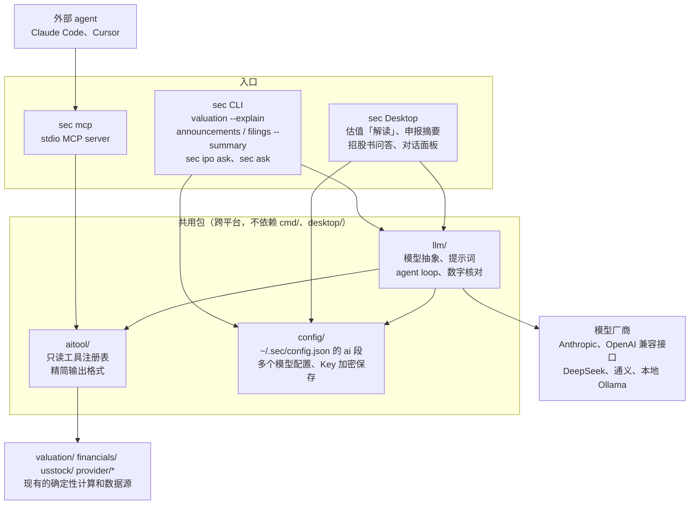

# AI/LLM 接入设计

本文记录 sec 接入大模型的设计和拆分。实现进度见 [TODO](../TODO.md) 的 AI/LLM 部分，每一步一个 PR，本文只描述方案，不对应代码。

## 目标与边界

sec 已经能从官方和公开数据源算出行情、财报、估值和宏观数据，缺的是「把多个结果串起来、用人话解释」。接入大模型只补这一层：

- **数字只来自 sec**：所有数值、同比、变化量和估值都由 Go 代码算好交给模型，模型只负责选择调用哪些工具、串联结果和解释，不自己计算、不估算、不补全缺失值。
- **口径原样保留**：推导标记 `*`、以 `_note` 结尾的说明（`source_note`、`shares_note`、`dividends_note`、`peers_note` 等）和数据截止日期原样交给模型，回答里必须保留。`null` 表示上游缺失或不适用，不能说成 0。
- **不给买卖建议**：只解释数据，不说买入、卖出、持有、目标价或仓位（国内证券投资咨询需持牌）。估值的 `assessment`（偏低区间、合理区间、偏高区间）是规则机械判定，回答里要说明这一点，并带上 `disclaimer`。
- **CLI 和 Desktop 都支持**：模型配置、提示词、数字核对和 agent loop 两边共用，同一个功能在 CLI 和 Desktop 上行为一致。`sec mcp` 另外给 Claude Code、Cursor 等外部 agent 使用，不需要配置模型。

不做：自动交易、定时自主运行的 agent、embedding 向量库、把模型输出写回 sec 的数据或缓存（摘要缓存除外，见下文）。

## 整体结构



`sec mcp` 不经过 `llm/`，也不读模型配置：模型由外部 agent 自己提供，sec 只提供工具。

新增两个跨平台包，都放在仓库根目录，和 `valuation/`、`financials/` 同级：

- **`aitool/`**：工具注册表和精简输出格式。只依赖现有的业务包和 provider，不依赖 `cmd/`、`desktop/` 和任何模型 SDK。`sec mcp`、`sec ask` 和 Desktop 对话都从这里取工具。
- **`llm/`**：模型接入抽象、提示词组装、agent loop 和数字核对，CLI 和 Desktop 共用。

模型配置放在已有的 `config/` 包（`~/.sec/config.json`），不新建配置文件。

`cmd/` 和 `desktop/` 只做入口：参数解析和终端输出、HTTP 接口和界面。凡是两边共用或要在 Linux CI 上测的逻辑（工具输出、提示词组装、agent loop、数字核对）都放在 `aitool/` 和 `llm/` 里，`desktop/` 只能在 Windows 和 macOS 上编译，不放这些逻辑。

## 工具注册表（aitool）

### 接口

```go
// Tool 是一个只读工具，参数和返回都是 JSON。
type Tool struct {
	Name        string          // 英文 snake_case，如 get_valuation
	Description string          // 给模型看的中文说明：做什么、什么时候用、返回什么
	InputSchema json.RawMessage // JSON Schema，MCP 和模型 tool use 共用
	Call        func(ctx context.Context, input json.RawMessage) (*Result, error)
}

// Registry 按名字查找工具，顺序固定，便于测试和生成文档。
type Registry struct{ ... }

func Default(macro MacroSource) *Registry // 第一批 7 类工具；宏观数据由 cmd/macro 注入，见 sec mcp 文档
```

工具全部只读：不改自选、不写配置、不下载文件。参数错误返回带中文说明的 error，上游失败返回 error 并写日志；MCP 和对话都把 error 文本原样交给模型，让它告诉用户哪一步失败了，不让它猜数据。

### 精简输出格式

`--json` 的结构面向脚本，字段多、历史长（10 年财报、几百根 K 线），直接交给模型既费 token，又容易让模型自己去算同比。工具输出另定一个带版本号的信封，不直接暴露 `--json` 的结构（[JSON 输出约定](json.md) 里已经说明）：

```json
{
  "schema_version": "1",
  "tool": "get_valuation",
  "subject": {"code": "SH600519", "name": "贵州茅台", "currency": "CNY"},
  "as_of": "2026-11-05",
  "source": "东方财富估值、业绩报表；新浪行情",
  "notes": ["PE、PB 历史分位按近 10 年日数据计算", "股息率用最近一个完整财年的现金分红"],
  "disclaimer": "估值结果由规则和假设机械计算，不构成投资建议。",
  "data": { ... }
}
```

- `as_of` 是数据本身的截止日期（交易日、报告期或统计期），不是查询时间。同一个结果里有多个时点（比如价格是今天、财报是上季度）时，`data` 里对应的部分各带自己的日期。
- `notes` 汇总所有非空的 `*_note` 和推导说明；带 `*` 的推导值在 `data` 里用 `"derived": true` 标出，不靠字符串里的星号。
- 派生值在工具里算好：同比、环比、区间涨跌幅、最大回撤、历史分位等，模型只需引用。
- 每个工具有输出预算（目标 4 KB 以内），超出时截短历史并在 `notes` 里写明截了什么。

### 第一批工具

| 工具 | 复用 | 输出要点 |
| --- | --- | --- |
| `search_security` | `provider/sina` 搜索 | 代码、名称、市场、证券类型，最多 10 条 |
| `get_quote` | `cmd/quote` 用到的行情 provider | 最新价、涨跌幅、成交额、时间和时区；基金净值标明 `nav` |
| `get_kline_summary` | `provider/eastmoney` K 线 | 区间首尾价、涨跌幅、最高最低、最大回撤、均线、平均成交额，加最近 20 根 K 线；不返回全部 K 线 |
| `get_financials` | `financials/`（A 股）、`financials.FromSEC`（美股） | 最近 5 个年度（或 8 个季度）的营收、净利润、毛利率、ROE、经营现金流等关键项及同比；A 股和美股统一成同一结构 |
| `get_valuation` | `valuation.Analyze` | PE/PB/PS 及历史分位、股息率、PEG、DCF 情景、`signals` 和 `assessment`、全部 `_note`、`disclaimer` |
| `list_filings` | `provider/cninfo` 公告、`provider/edgar` 申报 | 标题、类型、日期、链接，最多 20 条；不含正文 |
| `get_macro_series` | `provider/macrodata` 统一导出 | 按 `series` 的口径说明（频率、季调、价格基准）+ 最近 12 期观测；同比用官方值或标明是计算值 |

宏观指标很多，`get_macro_series` 用一个 `indicator` 参数加枚举，枚举从 Desktop 宏观页已有的目录生成，不为每个指标单独建工具。

## sec mcp

- 命令：`sec mcp`，stdio 传输，只暴露 `aitool.Default(macro.AISource())` 里的工具，不暴露 resources 和 prompts。
- stdout 只给 MCP 协议用：日志一律写 stderr，任何 `fmt.Print` 都不能走到 stdout。
- 实现优先用官方 Go SDK（`github.com/modelcontextprotocol/go-sdk`），新增依赖在该 PR 里评估；如果不合适再手写 JSON-RPC。
- 每次工具调用设超时（默认 30 秒，和 Desktop 的美股接口一致），复用现有的 HTTP 重试和缓存。
- 文档 `docs/mcp.md` 给出 Claude Code、Cursor 的配置示例，并说明输出格式和版本。

## 模型接入（llm）

### 抽象

```go
type Client interface {
	// Chat 发一轮请求，返回文本或工具调用。
	Chat(ctx context.Context, req Request) (*Response, error)
}

type Request struct {
	System   string
	Messages []Message
	Tools    []aitool.Spec // 名字、说明、InputSchema
	MaxTokens int
}
```

两个实现，都用 `net/http` 直接调用，不引入厂商 SDK，依赖保持最少：

- **Anthropic**：Messages API，原生 tool use。
- **OpenAI 兼容**：Chat Completions + function calling，覆盖 OpenAI、DeepSeek、通义千问和本地 Ollama，通过 `base_url` 区分。

不支持工具调用的模型只能用解读和摘要，不能用 `sec ask` 和对话面板，CLI 报错和设置页都给出提示。

第一版不做流式输出：解读和摘要一次性返回，`sec ask` 和对话面板按轮显示。流式输出等对话稳定后再加。

### 配置与密钥

CLI 和 Desktop 共用一份配置，在任意一边设置后另一边直接可用。

| 配置 | 存放位置 |
| --- | --- |
| 是否启用、默认配置、各个模型配置 | `~/.sec/config.json` 新增的 `ai` 段，和 `sec_edgar_email` 同一个文件，沿用现有的文件锁 |
| API Key | 每个配置各自一个：环境变量，或 `config.json` 里加密保存的 Key |
| 加密密钥 | `~/.sec/secret.key`，首次保存 Key 时生成，和 `config.json` 分开存放，所有配置共用 |

`config.json` 的 `ai` 段可以保存多个模型配置，每个配置写明厂商、模型和 Key，协议和地址默认用厂商的官方设置，切换时只改 `default` 或临时指定，不用改别的字段：

```json
{
  "sec_edgar_email": "you@example.com",
  "ai": {
    "enabled": true,
    "default": "claude",
    "profiles": {
      "claude": {
        "provider": "anthropic",
        "model": "claude-sonnet-5-5",
        "api_key": "enc:v1:3q2+7w...（base64）"
      },
      "ds": {
        "provider": "deepseek",
        "model": "deepseek-chat",
        "api_key": "enc:v1:9xk2Lm...（base64）"
      },
      "local": {
        "provider": "ollama",
        "model": "qwen3"
      },
      "gw": {
        "provider": "custom",
        "api": "openai",
        "base_url": "https://llm.corp.example/v1",
        "model": "x",
        "api_key_env": "CORP_LLM_KEY"
      }
    }
  }
}
```

- `profiles` 是以配置名为键的对象，名字天然唯一，命令里直接用名字引用。名字只能用小写字母、数字和 `-`，以字母或数字开头，最长 32 个字符。Desktop 下拉框按名字排序显示。
- `default` 是不指定时使用的配置，必须是 `profiles` 里存在的名字。
- `provider` 是模型厂商，必填，只能从内置列表里选（`config.AIProviders`），列表给出每个厂商的显示名、默认协议、官方地址和默认环境变量：

  | `provider` | 厂商 | 默认 `api` | 官方地址 | 默认环境变量 |
  | --- | --- | --- | --- | --- |
  | `anthropic` | Anthropic | `anthropic` | `https://api.anthropic.com` | `ANTHROPIC_API_KEY` |
  | `openai` | OpenAI | `openai` | `https://api.openai.com/v1` | `OPENAI_API_KEY` |
  | `deepseek` | DeepSeek | `openai` | `https://api.deepseek.com` | `DEEPSEEK_API_KEY` |
  | `qwen` | 通义千问（阿里云百炼） | `openai` | `https://dashscope.aliyuncs.com/compatible-mode/v1` | `DASHSCOPE_API_KEY` |
  | `moonshot` | 月之暗面 Kimi | `openai` | `https://api.moonshot.cn/v1` | `MOONSHOT_API_KEY` |
  | `zhipu` | 智谱 GLM | `openai` | `https://open.bigmodel.cn/api/paas/v4` | `ZAI_API_KEY` |
  | `ollama` | Ollama（本地） | `openai` | `http://localhost:11434/v1` | 无 |
  | `custom` | 自定义（自建网关、代理等） | 必填 | 必填 | 无 |

  通义千问和 Kimi 分中国和国际两个区域，Key 只能在签发它的区域使用，默认是中国区域，国际区域的 Key 要填 `base_url`。其他厂商用 `custom`。厂商列表用于默认值、隐私提示和以后 `llm/` 里各厂商的差异处理，列表外的值是无效配置，不猜测。
- `api` 是接口协议：`anthropic`（Messages API）或 `openai`（OpenAI 兼容接口），为空时用厂商的默认协议。部分厂商同时提供两种协议（比如 DeepSeek 的 Anthropic 兼容接口），这时填 `api` 和对应的 `base_url`：官方地址只对应默认协议，`api` 和默认协议不同时 `base_url` 必填。
- `base_url` 为空时用厂商的官方地址；`custom` 必须填 `api` 和 `base_url`；`model` 必填。`base_url` 不能带用户名密码、`#` 片段，也不能在查询参数里放 Key、token 或密码（`api-version` 这类普通参数可以），地址会明文写进文件。
- 每个配置只有一个 `api_key`（密文）；`api_key_env` 指定从哪个环境变量读 Key。本地模型两者都可以不填。
- Key 的读取顺序：
  1. `api_key_env` 非空时读这个环境变量；
  2. 否则读 `api_key` 解密；
  3. 都没有时，读厂商的默认环境变量（见上表）。`base_url` 改成官方地址以外的地址时不读（只差结尾的 `/` 仍算官方地址），避免把厂商的 Key 发给别的服务。

  默认环境变量按厂商区分，DeepSeek 配置不会误用 `OPENAI_API_KEY`。环境变量适合 CI、服务器和临时覆盖。
- 是否本机按实际地址判断（`localhost` 或回环地址），不按厂商：本机模型的查询内容不出本机，隐私提示据此说明；指向其他主机的 Ollama 不算本机。
- 以后需要按配置区分的设置（如 `max_tokens`、超时）作为可选字段加到每个配置里，属于兼容变更，第一版不加。

### 选择配置

- **CLI**：所有调用模型的命令（`--explain`、`--summary`、`sec ipo ask`、`sec ask`）都支持 `--ai <配置名>`，不写时用 `default`。
- **Desktop**：解读按钮、摘要按钮和对话面板旁边有配置下拉框，默认选中 `default`；临时切换只对当前页面有效，不改 `default`，要改默认值去设置页。
- 缓存键里的「模型」用配置实际的 `api` + `base_url` + `model`，不用配置名，改名或复制配置不会让缓存失效，换了模型才会重新调用。

### API Key 加密

- **算法**：AES-256-GCM，只用 Go 标准库 `crypto/aes`、`crypto/cipher`，不新增依赖。每次加密用新的随机 nonce，配置名作为附加认证数据（AAD），把一个配置的密文复制到另一个配置下会解密失败。
- **格式**：`enc:v1:` + base64(nonce ‖ 密文)。`v1` 留给以后更换算法或密钥来源。
- **加密密钥**：`~/.sec/secret.key` 存 32 字节随机数，首次保存 Key 时用 `crypto/rand` 生成，文件权限 `0600`（Windows 上只授权当前用户）。读取时发现权限过宽就报错，提示修正。
- **防护范围**：`config.json` 单独泄露（贴到 issue 里排查问题、同步 dotfiles、备份到网盘）时 Key 不会泄露；`config.json` 可以放心用 `sec config` 显示和分享。不防能读取用户主目录的本机程序，它能同时读到 `secret.key`。文档和设置页都如实说明这一点，不称之为「安全存储」，并提醒不要把 `secret.key` 和 `config.json` 一起同步或备份。
- **密钥丢失**：`secret.key` 被删或换了机器后，已保存的 Key 无法解密。此时报错「API Key 无法解密，请重新设置」，不自动删除密文；重新设置时生成新密钥并覆盖。
- **以后增强**：可以把 `secret.key` 改存到系统钥匙串（macOS Keychain、Windows Credential Manager），`config.json` 的格式不用变，用 `v2` 区分。第一版不做，避免引入依赖和处理没有钥匙串的 Linux。

设置方式：

- **CLI**：配置是嵌套结构，用 `sec config set` 的点号路径太长，改为 `sec config ai` 子命令：

  ```bash
  sec config ai list                     # 列出所有配置：名字、厂商、协议、地址、模型、Key 来源和末 4 位，标出 default
  sec config ai add ds --provider deepseek --model deepseek-chat
  sec config ai add gw --provider custom --api openai --base-url https://llm.corp.example/v1 --model x
  sec config ai edit ds --model deepseek-reasoner   # 修改 provider、api、base-url、model、api-key-env
  sec config ai set-key deepseek         # 设置 Key
  sec config ai unset-key deepseek       # 删除保存的 Key
  sec config ai use deepseek             # 设为 default
  sec config ai test deepseek            # 发一个最小请求测试连接
  sec config ai remove deepseek
  sec config ai enable / disable
  ```

  - `set-key` 在终端里隐藏输入，非终端（管道）时从 stdin 读一行，不接受命令行参数，避免 Key 进 shell 历史和进程列表。
  - 第一次 `add` 的配置自动成为 `default`；不能删除 `default` 指向的配置，要先 `use` 另一个。
  - 第一版不提供改名：Key 加密绑定了配置名，改名需要重新加密，等有需要再加 `rename`。
  - `sec config get/set` 继续只管 `sec_edgar_email` 这类单值配置，`sec config` 显示全部配置时 `ai` 段的 Key 只显示来源和末 4 位。
- **Desktop**：设置页列出所有配置，可以新增、编辑、删除、设为默认、保存 Key 和测试连接，规则和 CLI 一致，都通过同一个 `config` 包读写。

约束：

- 明文 Key 不写入任何文件，不在 `sec config`、接口和日志里回显，只显示「已设置」和末 4 位。
- Desktop 前端提交 Key 后，后端不在任何接口里返回 Key 或密文。
- 本地模型（Ollama 等）可以不填 Key。
- `ai` 段和其他配置分开解析。`ai` 段无效（比如手动编辑后 `default` 指向不存在的配置，或 `"enabled": "yes"` 这样的类型错误）时，读取时忽略整个 `ai` 段并提示，相当于未启用；修改配置时不覆盖文件，提示手动修正，避免丢掉已保存的 Key。其他配置项无效或类型不对时只把它们换成默认值，`ai` 段照常保留；只有文件根本不是 JSON 对象时才整体使用默认配置。校验错误不回显填的值，Key 填错位置时不会出现在提示和日志里。
- 默认关闭，用户主动配置后才启用。首次启用时 CLI 和设置页都提示：查询的证券、自选股和工具结果会发送给所选厂商，本地模型的数据不出本机。

### 提示词

系统提示词放在 `llm/prompts/`，带版本号，随代码审查。核心约束：

1. 只能使用工具返回的数字，回答里的每个数字都要能在工具结果里找到；工具没有给出的数值就说「数据中没有」。
2. 保留 `notes`、`disclaimer` 和各数据的截止日期；不同截止日期的数据放在一起时要分别说明。
3. 不给买卖、持有、目标价、仓位建议；`assessment` 要说明是规则判定。
4. 用中文回答，数字保留工具给出的精度和单位。

### 数字核对

提示词约束靠不住，所以加一层确定性检查，在 `llm` 包里实现，解读、摘要和对话都用：

- 从回答中提取所有数字（含百分号、万/亿单位），归一化后和本次所有工具结果里的数字比对，允许四舍五入误差。
- 找不到来源的数字在界面上标出来，并在回答下方提示「以下数字未在数据中找到」。
- 回答出现买入、卖出、加仓、减仓、目标价等词时同样标出。

核对只提示、不拦截，误报率在离线评测里统计后再决定是否收紧。

## 各功能设计

每个功能在 `llm/` 里实现一次，CLI 和 Desktop 只是两个入口，提示词、数字核对和缓存都共用。模型未配置时，CLI 报错并提示 `sec config ai add ...`，Desktop 按钮置灰并提示去设置页。CLI 的 `--json` 输出回答文本、核对结果和所用工具结果的 `as_of`，便于脚本使用。

### 估值解读

- 入口：CLI `sec valuation <code> --explain`，在估值表格后输出解读；Desktop 估值 tab 右上角的「解读」按钮，调用新接口 `POST /api/v1/ai/valuation`。
- 实现：调用 `get_valuation` 工具取精简输出，组装提示词，不开放工具调用（单轮）。
- 输出：一段 300 字以内的说明，分「估值水平」「历史位置」「数据口径」三部分，末尾附 `disclaimer`，下方是数字核对结果。
- 缓存：按 证券代码 + `as_of` + 模型 + 提示词版本 缓存在 `~/.sec/cache/ai/`，CLI 和 Desktop 共用，同一天重复调用不再请求模型。

### 申报与公告摘要

入口：CLI 在 `sec announcements`、`sec filings` 上加 `--summary <序号或链接>`，招股书问答用 `sec ipo ask <代码> "<问题>"`；Desktop 在对应列表的每一行加「摘要」按钮，招股书页加问答框。

长文档不整篇交给模型：先在 Go 里切出需要的部分，按页或按节分块，每块带位置信息，再让模型逐块摘要后合并。所有摘要都附原文链接和位置（页码或章节）。

1. **巨潮公告摘要**：PDF 转文本按页分块（需要新增 PDF 文本提取依赖，在该 PR 里评估），摘要附页码。
2. **美股 8-K 事项摘要**：按 Item 编号切分（Item 1.01、2.02、5.02 等），每个事项一段。
3. **10-K Risk Factors 和 MD&A**：从 EDGAR HTML 按章节标题切出 Item 1A 和 Item 7；风险因素逐年对比时，先在 Go 里按小标题做新增、删除、保留的确定性对比，模型只解释变化，不负责找差异。
4. **招股书 PDF 问答**：按页分块，用关键词检索（BM25）取最相关的几页交给模型，回答必须附页码；检索不到相关页就回答「招股书中未找到」。

摘要缓存键为 文档 ID + 模型 + 提示词版本，文档不变时不重复调用。

### 问答：sec ask 与 Desktop 对话面板

- agent loop 在 `llm` 包里实现：模型返回工具调用 → 从 `aitool` 注册表执行 → 结果回传，最多 8 轮，单次工具调用 30 秒超时，整轮可取消（CLI 用 Ctrl-C）。
- CLI：`sec ask "<问题>"` 单次问答，stderr 逐行显示调用了哪个工具和截止日期，stdout 输出回答和数字核对结果；`--code <代码>` 带入证券上下文。第一版不做多轮交互。
- Desktop：对话面板显示每一步调用的工具、参数和截止日期，回答下方显示数字核对结果；当前研究页的证券作为上下文默认带入，用户可以去掉。
- 对话历史只保存在内存，CLI 命令结束或 Desktop 关闭窗口即清空；以后要保存再单独设计。

## 测试

- **CI 不调用真实模型**：`llm` 包提供假的 `Client`，按脚本返回文本或工具调用，用来测试 agent loop、提示词组装、数字核对和错误处理。
- **工具输出**：用 `gock` 录制上游响应，对精简输出做 golden 测试，确认派生值、`notes`、`as_of` 和输出预算。
- **sec mcp**：在测试里用内存管道启动 server，测试 `tools/list` 和 `tools/call`。
- **配置**：`config` 包测试 `ai` 段的读写、校验和旧文件兼容；多个配置的增删改、`default` 校验、Key 读取顺序；Key 加密解密往返、篡改密文、密文复制到其他配置、`secret.key` 丢失和权限过宽的报错；测试在临时目录里进行，不碰真实的 `~/.sec`。
- **CLI 入口**：用假客户端测试 `--explain`、`--summary`、`sec ask` 的终端输出和 `--json`。
- **回答质量**：离线评测集放在 `testdata/aieval/`，每条包含问题、期望调用的工具、必须出现的口径说明、禁止出现的词；用 `go run ./scripts/aieval` 对真实模型手动运行，输出数字核对失败率和违规次数，不进 CI。

## 拆分顺序与完成标准

| 顺序 | PR | 完成标准 |
| --- | --- | --- |
| 1 | Agent Skill 与文档（已完成，见[使用说明](agent-skill.md)） | 一份 SKILL.md，说明各命令用 `--json`、macro 用 `--standard-json`，以及口径说明和不给建议的要求；不改 Go 代码 |
| 2 | `aitool` 注册表与 `sec mcp` | 先做框架和 `get_quote`（已完成，见 [sec mcp](mcp.md)），其余 6 个工具一个一个 PR；每个工具的精简输出带测试；`sec mcp` 能在 Claude Code 里列出并调用工具 |
| 3 | 共用 AI 配置 | `config.json` 的 `ai` 段和多个模型配置、Key 加密存储和 `secret.key`、`sec config ai` 子命令（`test` 除外）；不调用模型 |
| 4 | `llm` 抽象 | 两种接口的适配器和假客户端、数字核对模块、`sec config ai test` 测试连接、各命令的 `--ai` 参数 |
| 5 | Desktop 模型设置 | 设置页编辑 `ai` 段、保存 Key、测试连接、隐私提示 |
| 6 | 估值解读 | `llm` 里的解读逻辑和缓存，CLI `--explain`；用假客户端测试提示词组装和核对 |
| 7 | Desktop 估值「解读」按钮 | 接口和按钮，复用第 6 项 |
| 8a | 巨潮公告摘要 | PDF 分块和页码引用，CLI `--summary` 和 Desktop 按钮 |
| 8b | 美股 8-K 事项摘要 | 按 Item 切分，CLI 和 Desktop 入口 |
| 8c | 10-K Risk Factors 和 MD&A | 章节切分和确定性逐年对比，CLI 和 Desktop 入口 |
| 8d | 招股书 PDF 问答 | 关键词检索和页码引用，`sec ipo ask` 和 Desktop 问答框 |
| 9 | `sec ask` | agent loop、工具调用展示、取消；评测集第一版 |
| 10 | Desktop 对话面板 | 复用第 9 项的 agent loop，界面展示 |

功能先在 `llm/` 里实现并接上 CLI 入口，再单独提 PR 接 Desktop 界面，每个 PR 更小，也让逻辑先在 Linux CI 上测过。第 8 组的四项互不依赖，可以按需要调整顺序；单项改动不大时，CLI 和 Desktop 入口可以放在同一个 PR 里。
